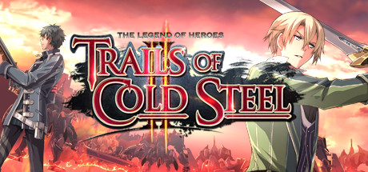

**Trails of Cold Steel II directly continues from the first game's shocking finale, with Rean fighting to end the civil war tearing Erebonia apart. Features an expanded roster, new Divine Knight mech battles, and a resolution to the empire's deepest conflicts.**

---

## 📖 About

Trails of Cold Steel II directly continues from the first game's shocking finale, with Rean fighting to end the civil war tearing Erebonia apart. Features an expanded roster, new Divine Knight mech battles, and a resolution to the empire's deepest conflicts.

## ⚠️ Problems Without Trainer

| Problem | Status |
|---------|--------|
| **Continuity Dependency** — Deeply tied to CS1 story; impossible to follow without playing first | ✅ Solved |
| **Divine Knight Battles** — Mech combat sections require learning a different tactical system | ✅ Solved |
| **Nightmare Difficulty** — Highest difficulty makes late encounters extremely punishing | ✅ Solved |
| **Bonding Carryover** — Missing CS1 bonds means starting CS2 links from lower levels | ✅ Solved |

## ✅ Solution

The **The Legend of Heroes: Trails of Cold Steel II Trainer** solves all these issues by giving you complete control over the game.

## 🎯 Full Feature List

- Unlimited Resources
- God Mode / Invincibility
- Instant Skill Cooldown
- One-Hit Kill
- Freeze Game Timer
- Unlock All Items & Achievements
- Custom Speed Multiplier
- Save State Anywhere

## 🚀 Quick Start

1. **Disable Windows Defender** temporarily (trainer may trigger false positive)
2. Download the trainer from the button above
3. Launch The Legend of Heroes: Trails of Cold Steel II
4. Run the trainer as Administrator
5. Activate desired cheats with hotkeys

## 💎 Free vs Paid

| Feature | Free | Pro |
|---------|------|-----|
| Basic God Mode | ✅ | ✅ |
| Unlimited Resources | ✅ | ✅ |
| All Advanced Cheats | ❌ | ✅ |
| Auto-Updates | ❌ | ✅ |
| Priority Support | ❌ | ✅ |

## 💻 Requirements

- Windows 10/11 (64-bit)
- The Legend of Heroes: Trails of Cold Steel II (any version)
- .NET Framework 4.8+
- DirectX 11+

## 🍎 macOS

macOS users can use our alternative tool:

## ⚖️ Legal

This trainer is for educational and single-player use only. Use responsibly.

---

